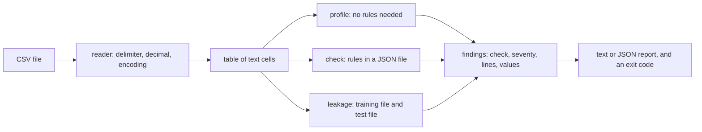

# table-audit

[](https://github.com/juanbezerra1/table-audit/actions/workflows/ci.yml)

**Look at a data table before you trust it: a command-line auditor for CSV files that finds duplicates, impossible values, codes for "missing" and leakage between a training file and a test file. Python standard library only.**

A table of measurements (one row per recording, per visit, per participant) is saved from Excel, fixed by hand, merged with
another one and finally handed to a model. What goes wrong on the way is small and silent: a `-999` that is read as a force,
`F` and `f` counted as two sexes, a row pasted twice, the same participant in the training file and in the test file.
`table-audit` is the look at the table that you should take before the model does. It reads files the way they really come
out of Excel in Brazil (`;` between cells, `,` inside numbers, the Windows code page), says what it found and on which lines,
and ends with an exit code that a script can trust. Every table in its examples is synthetic.

Português: [README.pt-BR.md](README.pt-BR.md)

## At a glance

| | |
|---|---:|
| Commands | 4 |
| Checks, each with a name and a fixed severity | 33 |
| Keys that a rule for a column may have | 7 |
| Dependencies | 0 |
| Ways the tests are broken on purpose, all noticed | 23 |

If you only have five minutes: run the three commands of the [quick start](#quick-start), read what the tool
[cannot tell you](#limits), and skim the list of [checks](#the-checks).



## Quick start

You need Python 3.10 or newer. There is nothing else to install.

```bash
git clone https://github.com/juanbezerra1/table-audit.git
cd table-audit
py -m pip install .
```

On Linux or macOS write `python3 -m pip install .`. Once it is installed, `py -m table_audit ...` does the same as
`table-audit ...`. The folder [`examples/`](examples) has synthetic tables that are dirty on purpose, and what follows
runs on them.

### `profile`: what is wrong with this table, with no rules

```console
$ table-audit profile examples/participants.csv --key subject_id,visit
table-audit 0.1.0: profile

file    participants.csv
shape   36 rows x 6 columns
format  delimiter ';' (detected), decimal ',' (detected), encoding utf-8

columns
  column        kind   missing  distinct         min         max
  ------------  -----  -------  --------  ----------  ----------
  subject_id    text         2        15
  visit         int          1         3           1           3
  sex           text         1         3
  age           int          1        15          17         205
  grip_force_n  float        1        31        -999        53.4
  visit_date    date         2        20  2025-12-31  2026-04-08

findings: 2 errors, 8 warnings, 1 info
  error   ragged-rows         1 row does not have the 6 cells of the header (padded or cut to fit) (line 27)
  error   duplicate-key       (subject_id, visit) is not unique: 2 keys appear more than once (2 extra rows) (lines 24, 37; e.g. 'P0009/2', 'P0014/1')
  warning empty-rows          1 row has no value at all (line 14)
  warning whitespace          sex: 1 value has spaces at the start or end (a join will miss them) (line 29; e.g. 'M ')
  warning label-variants      sex: 1 label is written in more than one way (case, accents or spaces) (lines 7, 22; e.g. 'F / f')
  warning mixed-types         grip_force_n: 2 values are not numbers (1 written with '.' instead of ',') (lines 25, 32; e.g. 'ND', '27.5')
  warning placeholder         grip_force_n: 2 values look like a code for 'missing', not a measurement (lines 5, 16; e.g. '-999')
  warning mixed-types         visit_date: 1 value is not a date (line 13; e.g. '2026-02-30')
  warning date-formats        visit_date: dates are written in two ways: 32 like 2026-03-02 and 1 like 02/03/2026 (line 20; e.g. '05/03/2026')
  warning duplicate-rows      1 row repeats an earlier row exactly (spaces at the ends ignored) (line 24)
  info    outliers            age: 1 value is more than 6 robust deviations from the median (line 30; e.g. '205')

result: FAILED (2 errors)
```

Read it from the bottom: the verdict, the findings (errors first, then warnings, then information), the columns. Lines are
the lines of the file as an editor shows them (the header is line 1). The number in a message counts everything; the lines
and values in brackets are only the first five. `--key subject_id,visit` says that this pair must be unique, which is
where the second error comes from (line 24 is also the repeated row, and the report says both). On a table with nothing
to say the report is short:

```console
$ table-audit profile examples/train.csv
table-audit 0.1.0: profile

file    train.csv
shape   40 rows x 8 columns
format  delimiter ',' (detected), decimal '.' (detected), encoding utf-8

columns
  column          kind   missing  distinct         min         max
  --------------  -----  -------  --------  ----------  ----------
  subject_id      text         0        10
  session         int          0         4           1           4
  date            date         0        20  2026-03-03  2026-04-16
  rms_uv          float        0        40        8.73       22.86
  mnf_hz          float        0        36        72.1       111.3
  site            text         0         3
  artifact_score  float        0        38       0.081       0.947
  qc              text         0         2

findings: none

result: ok
```

### `check`: the table against rules that you wrote

Rules are a JSON file, so they can live next to the data and be reviewed like code:

```json
{
  "columns": {
    "subject_id": {"type": "text", "not_null": true, "pattern": "P\\d{4}"},
    "visit": {"type": "int", "min": 1, "max": 4},
    "sex": {"allowed": ["F", "M"]},
    "age": {"type": "int", "min": 18, "max": 90},
    "grip_force_n": {"type": "float", "min": 0, "max": 80},
    "visit_date": {"type": "date", "min": "2026-01-01"}
  },
  "unique": [["subject_id", "visit"]]
}
```

```console
$ table-audit check examples/participants.csv --rules examples/rules.json
table-audit 0.1.0: check

file    participants.csv
shape   36 rows x 6 columns
format  delimiter ';' (detected), decimal ',' (detected), encoding utf-8
rules   rules.json

findings: 10 errors, 1 warning
  error   ragged-rows         1 row does not have the 6 cells of the header (padded or cut to fit) (line 27)
  error   not-null            subject_id: 2 cells are empty or missing (lines 10, 14)
  error   pattern             subject_id: 1 value does not match the pattern P\d{4} (line 17; e.g. 'P12')
  error   not-allowed         sex: 2 values are not in the allowed list (F, M) (lines 7, 22; e.g. 'f')
  error   out-of-range        age: 2 values are outside 18 to 90 (1 below, 1 above) (lines 9, 30; e.g. '17', '205')
  error   wrong-type          grip_force_n: 2 values are not numbers (1 written with '.' instead of ',') (lines 25, 32; e.g. 'ND', '27.5')
  error   out-of-range        grip_force_n: 2 values are outside 0 to 80 (lines 5, 16; e.g. '-999')
  error   wrong-type          visit_date: 1 value is not a date (line 13; e.g. '2026-02-30')
  error   out-of-range        visit_date: 1 value is below the minimum 2026-01-01 (line 2; e.g. '2025-12-31')
  error   duplicate-key       (subject_id, visit) is not unique: 2 keys appear more than once (2 extra rows) (lines 24, 37; e.g. 'P0009/2', 'P0014/1')
  warning empty-rows          1 row has no value at all (line 14)

result: FAILED (10 errors)
```

Everything that the rules forbid is an `error`: you wrote the rule, so you decided it matters. The cells that fail a type
are not checked again against the range (`ND` is "not a number", it is not also "outside 0 to 80"). A mistake in the rules
file is reported with the place where it is, and the command exits with `2`:

```console
$ table-audit check examples/participants.csv --rules examples/rules-with-a-mistake.json
table-audit: error: rules-with-a-mistake.json: columns.age: unknown key 'maximum'; did you mean 'max'?
```

| Key of a column | What it says |
|---|---|
| `type` | `int`, `float`, `number`, `date`, `bool` or `text`. A date is `2026-03-02` or `02/03/2026` (day first) |
| `not_null` | `true`: an empty cell, or a word for "missing", is an error |
| `unique` | `true`: no value may appear twice |
| `min` | the lowest number, or the earliest date written as `"2026-01-01"` |
| `max` | the highest number, or the latest date |
| `allowed` | the list of values that may appear, as text or whole numbers |
| `pattern` | a regular expression that the whole value must match (not just a part of it) |

Outside the columns, `unique` is a list of lists of columns that must be unique together, and `no_extra_columns: true`
makes a column that the rules do not mention an error. A column with no rule is checked only for the structure of the
file (rows with the wrong number of cells, empty rows).

### `leakage`: a training file and a test file

```console
$ table-audit leakage examples/train.csv examples/test.csv --group subject_id --target qc --time date
table-audit 0.1.0: leakage

train  train.csv: 40 rows x 8 columns
test   test.csv: 16 rows x 8 columns

findings: 2 errors, 3 warnings
  error   group-overlap       3 of 5 subject_id values in the test file are also in the training file (8 of 16 test rows) (lines 2, 3, 4, 5, 6 and 3 more; e.g. 'S03', 'S02', 'S07')
  error   identical-rows      1 test row has the same values as a training row in all 7 columns compared (line 4)
  warning target-determined   site: each of its 3 values goes with a single qc in the training file; it may be derived from the target or stand in for it
  warning target-separated    artifact_score: one threshold on it separates the two classes of qc in the training file (AUC 1.000)
  warning time-order          5 test rows are dated before the last training date, 2026-04-16 (31% of the test file; the first test date is 2026-03-14) (lines 4, 10, 11, 14, 15)

result: FAILED (2 errors)
```

A model that is tested on rows it has, in effect, already seen reports a score that it will not have in use. In tables of
measurements that happens in a few old ways, and these are the ones that are looked for:

- **The same subject on both sides** (`--group subject_id`, one or more columns): a person who is in both files is the
  commonest leak, and an error. Here 3 of the 5 people of the test file are in the training file.
- **The same row on both sides**: a test row that has, in every column the two files share (except the target and
  `--ignore`), the values of a training row. Numbers are compared as numbers, so `1,50` and `1.5` are the same.
- **A column that carries the answer** (`--target qc`): every value of it goes with a single class (`target-determined`),
  or one threshold separates two classes perfectly (`target-separated`, AUC 1.000), or it is almost a copy of a numeric
  target, or a text column where every value is different, which a model can memorize. These are warnings, because a
  column can be legitimately that good.
- **A test that is older than the training** (`--time date`): rows dated before the last training date, when the split must
  respect the order of time.

What a clean report means is only that these looks found nothing. See the [limits](#limits).

## Files from Excel in Brazil

Nothing in a CSV file says how it was written, so the reader looks, and the report says what it chose (the `format` line
in the reports above). Each choice can be made by hand.

| What | How it is decided | To say it yourself |
|---|---|---|
| Delimiter | a comma, a semicolon, a tab or a vertical bar: the one that splits the first lines into the same number of cells. A file with one column and decimal commas is still one column | `--delimiter ";"` or `--delimiter tab` |
| Decimal separator | `,` when more cells look like `12,5` than like `12.5` | `--decimal ,` |
| Encoding | UTF-8, with or without a byte order mark; if that fails, the Windows code page (cp1252), then latin-1. The report has a note when it was not UTF-8 | `--encoding cp1252` |
| Missing | an empty cell, `NA`, `N/A`, `NaN`, `null`, `none`, `#N/A`, `-` and `?`, in any case | `--missing "ND,SD"` replaces the list |

`1,5` is a number in a file with decimal commas and a mistake in one with decimal points, and the report says so: "1 written
with '.' instead of ','" is what a file pasted together from two computers looks like.

## In a script or in CI

| Exit code | Meaning |
|---|---|
| `0` | nothing to fix. Warnings are allowed, unless `--strict` |
| `1` | the audit found errors (with `--strict`, warnings too) |
| `2` | the command, or a file, could not be understood: the reason is one line on stderr |

```yaml
- name: Audit the table before training
  run: table-audit check data/participants.csv --rules data/rules.json --strict
```

`--format json` prints the same report for a program to read. This is the finding of the `placeholder` check of the first
report, exactly as it is printed:

```json
{
  "check": "placeholder",
  "severity": "warning",
  "column": "grip_force_n",
  "message": "2 values look like a code for 'missing', not a measurement",
  "count": 2,
  "lines": [
    5,
    16
  ],
  "examples": [
    "-999"
  ]
}
```

The text report is plain ASCII (values that come from your file are shown as they are), so a Windows console in an old
code page, or a file that it is redirected to, does not turn it into question marks. Characters that the console cannot
show are replaced, and the program does not stop.

## The checks

Every finding names one check, and the severity belongs to the check: an `error` is wrong whatever the data means (a row
with the wrong number of cells, a key that you declared unique, a subject on both sides of a split), a `warning` is usually
wrong, `info` is good to know. `table-audit explain` prints this list, and `table-audit explain placeholder` explains one.

| Check | Severity | Commands | What it looks for |
|---|---|---|---|
| `encoding` | `info` | `profile`, `check` | the file is not UTF-8; it was read as the Windows code page |
| `column-name` | `error` | `profile`, `check` | a column without a name, or a name used by two columns |
| `ragged-rows` | `error` | `profile`, `check` | rows with more or fewer cells than the header |
| `blank-lines` | `info` | `profile`, `check` | blank lines in the file (they are skipped) |
| `empty-rows` | `warning` | `profile`, `check` | rows that have no value at all |
| `no-rows` | `warning` | `profile`, `check` | a header and nothing under it |
| `empty-column` | `warning` | `profile` | a column with no value in any row |
| `mixed-types` | `warning` | `profile` | numbers, dates or true/false with other things among them, or no clear type |
| `missing` | `warning` | `profile` | half of the rows, or more, have no value in a column |
| `constant` | `info` | `profile` | the same value in every row |
| `whitespace` | `warning` | `profile` | spaces at the start or the end of a value |
| `label-variants` | `warning` | `profile` | one label written in more than one way (case, accents, spaces) |
| `placeholder` | `warning` | `profile` | -999, 9999 and the like: a code for 'missing' used as if it were a measurement |
| `outliers` | `info` | `profile` | values more than 6 robust deviations away from the median |
| `date-formats` | `warning` | `profile` | dates written two ways in one column (2026-03-02 and 02/03/2026) |
| `duplicate-rows` | `warning` | `profile` | a row that repeats an earlier row exactly |
| `duplicate-key` | `error` | `profile`, `check` | a key (--key) or a column that must be unique, and is not |
| `missing-column` | `error` | `check` | the rules ask for a column that the table does not have |
| `extra-column` | `error` | `check` | a column that the rules do not mention (no_extra_columns) |
| `not-null` | `error` | `check` | an empty cell in a column that must have a value |
| `wrong-type` | `error` | `check` | a value that is not of the type the rules give the column |
| `out-of-range` | `error` | `check` | a number or date below the minimum or above the maximum |
| `not-allowed` | `error` | `check` | a value that is not in the list of allowed values |
| `pattern` | `error` | `check` | a value that does not match the regular expression of the column |
| `columns-differ` | `info` | `leakage` | columns that only one of the two files has |
| `group-overlap` | `error` | `leakage` | the same subject (or patient, or device) in training and in test |
| `identical-rows` | `error` | `leakage` | a test row that is a training row |
| `target` | `info` | `leakage` | too few rows, or a target that is neither a label nor a quantity: its checks are skipped |
| `id-like-column` | `warning` | `leakage` | a text column where every value is different |
| `target-determined` | `warning` | `leakage` | a column whose every value goes with a single class of the target |
| `target-separated` | `warning` | `leakage` | a column that one threshold turns into a perfect classifier of two classes |
| `target-copy` | `warning` | `leakage` | a column that is almost a copy of a numeric target |
| `time-order` | `warning` | `leakage` | test rows dated before the end of the training data |

```console
$ table-audit explain placeholder
table-audit 0.1.0: explain placeholder

severity  warning
commands  profile
looks for -999, 9999 and the like: a code for 'missing' used as if it were a measurement
```

## How it is built

| Module | What it does |
|---|---|
| `src/table_audit/values.py` | one cell: is it missing, a number, a date; what a label is once case and accents are gone |
| `src/table_audit/reader.py` | the file: delimiter, decimal separator, encoding, rows with the wrong number of cells |
| `src/table_audit/profile.py` | the checks that need no rules |
| `src/table_audit/rules.py` | the rules file, the messages for its mistakes, and the checks it asks for |
| `src/table_audit/leakage.py` | the four ways a split leaks, and the checks on the target |
| `src/table_audit/report.py` | findings, the list of checks, the text and JSON reports |
| `src/table_audit/cli.py` | the command line and the exit codes |

Choices that are worth knowing about:

- **Standard library only.** It can run on a lab machine where nothing can be installed, and a `pip install` of it brings
  nothing else. The price is speed and reach: no Excel files, no Parquet, no pandas.
- **Everything is text until a check asks for a type.** `007` is a code, not the number 7; `1,5` is a number only where
  the decimal separator is a comma; `2026-02-30` is not a date.
- **Medians, not means.** An outlier or a code for "missing" is judged by its distance from the median in units of the
  median absolute deviation (times 1.4826, to be comparable with a standard deviation), because a mean and a standard
  deviation are moved by the very values that are being looked for.
- **Thresholds are named constants** at the top of `src/table_audit/profile.py` and `src/table_audit/leakage.py`. They are
  judgements, and a judgement that is written down can be argued with.
- **A finding says how many, where and which.** `count` is the real number; `lines` and `examples` are the first five,
  because a report that lists ten thousand lines is not read.

## Tests

```bash
py -m pip install -e ".[dev]"
py -m ruff check .
py -m ruff format --check .
py -m mypy src tests scripts
py -m pytest
py scripts/mutation_check.py
```

The tests are of five kinds. **Unit tests** for each module, each check with a case where it speaks and a case where it
must keep quiet. **Tests of the documents** (`tests/test_docs.py`): they read this README as a stranger would, follow every
link, run every `console` block and compare its output with the real one, and compare the tables with the code, so a README
that has drifted from the program fails. **Tests of what is shipped** (`tests/test_packaging.py`): the wheel is built and
looked into, the version is the same everywhere, the CI tests the oldest and the newest Python that the project claims.
**Random files** (`tests/test_robustness.py`): thousands of nasty files, made by a seeded generator so that a failure can be
repeated (ragged rows, quotes that never close, binary noise, numbers that overflow), must give a report or a message,
never a traceback. And the **mutation check**: `scripts/mutation_check.py` breaks the program in 23 plausible ways, one at a
time in a temporary copy (a threshold moved, a comparison turned around, a strip forgotten), and every one is noticed by
the tests named next to it. A suite that passes proves little until you have seen it fail.

The CI (`.github/workflows/ci.yml`) runs `ruff`, `ruff format --check`, `mypy` in strict mode and `pytest` on Python 3.10,
3.13 and 3.14 on Linux and on 3.13 on Windows, and then runs the command on the examples.

## Limits

- **It finds the usual problems; it does not prove that a table is clean.** A report with no findings means that these
  looks found nothing. A split can still leak in ways that none of them knows: one person under two codes, a recording cut
  in two and sent to both sides, a column derived from the target in two steps.
- **The thresholds are judgements.** 90% of a column decides its type, 6 robust deviations make an outlier, half of the
  rows empty is "many". A table from another field may deserve other numbers, and there is no configuration file for them yet.
- **Dates are ISO (`2026-03-02`, with or without a time) or day first (`02/03/2026`).** Month first, two-digit years and
  `2026-3-2` are read as text. Time zones are ignored: the checks work on the day.
- **Numbers have no thousands separator and no unit.** `1.234,5` and `12 kg` are text. That is on purpose: a comma that can
  mean two things is something to report, not to guess.
- **`identical-rows` compares every column the two files share.** In a table with only categorical columns, different
  observations legitimately look the same; leave out with `--ignore` what should not count.
- **People are matched by their exact text** (spaces at the ends are trimmed): `S01` and `s01` are two people to it.
- **`placeholder` knows six codes** (-9999, -999, -99, 999, 9999, 99999), and calls one a placeholder only when it is far
  from the rest of its column.
- **The whole file is read into memory.** Profiling 100,000 rows of 8 columns took about 1.5 seconds, and 300,000 rows about
  5 seconds, on the Linux machine where I wrote it (Python 3.13). Excel files and Parquet are not read: save as CSV.
- **What I have run:** the tests, the linters and the mutation check on Python 3.10, 3.13 and 3.14, on Linux. The Windows
  job and the other jobs of the workflow I have not seen run on GitHub, and I have not run the program on Windows.
- **It is not on PyPI**; install it from a clone, as above.
- **The Python modules are not an API.** What I intend to keep is the command line, the exit codes and the JSON report.

## Repository layout

| Path | What is there |
|---|---|
| `src/table_audit/` | the package |
| `tests/` | the tests |
| `examples/` | three synthetic tables and two rules files, one of them with a mistake in it |
| `scripts/` | `mutation_check.py` |
| `.github/workflows/` | `ci.yml` |

## License

MIT, see [LICENSE](LICENSE).
