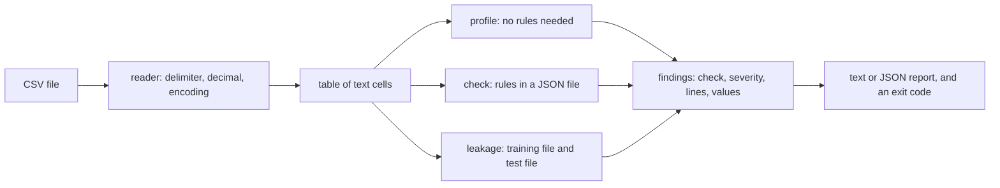

# table-audit

[](https://github.com/juanbezerra1/table-audit/actions/workflows/ci.yml)

**Olhe uma tabela de dados antes de confiar nela: um auditor de linha de comando para arquivos CSV que acha duplicatas, valores impossíveis, códigos de "ausente" e vazamento entre o arquivo de treino e o de teste. Só a biblioteca padrão do Python.**

Uma tabela de medidas (uma linha por gravação, por visita, por participante) é salva do Excel, corrigida à mão, juntada
com outra e, no fim, entregue a um modelo. O que dá errado no caminho é pequeno e silencioso: um `-999` lido como se
fosse uma força, `F` e `f` contados como dois sexos, uma linha colada duas vezes, o mesmo participante no arquivo de
treino e no de teste. O `table-audit` é o olhar sobre a tabela que você deveria dar antes do modelo. Ele lê os arquivos do
jeito que realmente saem do Excel no Brasil (`;` entre as células, `,` dentro dos números, a página de código do Windows),
diz o que achou e em que linhas, e termina com um código de saída em que um script pode confiar. Todas as tabelas dos
exemplos são sintéticas.

English: [README.md](README.md)

## Em resumo

| | |
|---|---:|
| Comandos | 4 |
| Checagens, cada uma com nome e severidade fixa | 33 |
| Chaves que a regra de uma coluna pode ter | 7 |
| Dependências | 0 |
| Jeitos de quebrar os testes de propósito, todos percebidos | 23 |

Se você só tem cinco minutos: rode os três comandos do [começo rápido](#começo-rápido), leia o que a ferramenta
[não consegue dizer](#limites) e passe os olhos na lista de [checagens](#as-checagens).



## Começo rápido

Você precisa do Python 3.10 ou mais novo. Não há mais nada para instalar.

```bash
git clone https://github.com/juanbezerra1/table-audit.git
cd table-audit
py -m pip install .
```

No Linux ou no macOS, escreva `python3 -m pip install .`. Depois de instalado, `py -m table_audit ...` faz o mesmo que
`table-audit ...`. A pasta [`examples/`](examples) tem tabelas sintéticas que são sujas de propósito, e o que vem a seguir
roda nelas. A saída do programa está em inglês, nos dois READMEs.

### `profile`: o que há de errado nesta tabela, sem regras

```console
$ table-audit profile examples/participants.csv --key subject_id,visit
table-audit 0.1.0: profile

file    participants.csv
shape   36 rows x 6 columns
format  delimiter ';' (detected), decimal ',' (detected), encoding utf-8

columns
  column        kind   missing  distinct         min         max
  ------------  -----  -------  --------  ----------  ----------
  subject_id    text         2        15
  visit         int          1         3           1           3
  sex           text         1         3
  age           int          1        15          17         205
  grip_force_n  float        1        31        -999        53.4
  visit_date    date         2        20  2025-12-31  2026-04-08

findings: 2 errors, 8 warnings, 1 info
  error   ragged-rows         1 row does not have the 6 cells of the header (padded or cut to fit) (line 27)
  error   duplicate-key       (subject_id, visit) is not unique: 2 keys appear more than once (2 extra rows) (lines 24, 37; e.g. 'P0009/2', 'P0014/1')
  warning empty-rows          1 row has no value at all (line 14)
  warning whitespace          sex: 1 value has spaces at the start or end (a join will miss them) (line 29; e.g. 'M ')
  warning label-variants      sex: 1 label is written in more than one way (case, accents or spaces) (lines 7, 22; e.g. 'F / f')
  warning mixed-types         grip_force_n: 2 values are not numbers (1 written with '.' instead of ',') (lines 25, 32; e.g. 'ND', '27.5')
  warning placeholder         grip_force_n: 2 values look like a code for 'missing', not a measurement (lines 5, 16; e.g. '-999')
  warning mixed-types         visit_date: 1 value is not a date (line 13; e.g. '2026-02-30')
  warning date-formats        visit_date: dates are written in two ways: 32 like 2026-03-02 and 1 like 02/03/2026 (line 20; e.g. '05/03/2026')
  warning duplicate-rows      1 row repeats an earlier row exactly (spaces at the ends ignored) (line 24)
  info    outliers            age: 1 value is more than 6 robust deviations from the median (line 30; e.g. '205')

result: FAILED (2 errors)
```

Leia de baixo para cima: o veredito, as ocorrências (erros primeiro, depois avisos, depois informações), as colunas. As
linhas são as do arquivo como um editor mostra (o cabeçalho é a linha 1). O número da mensagem conta tudo; as linhas e os
valores entre parênteses são só os cinco primeiros. `--key subject_id,visit` diz que esse par precisa ser único, e daí
vem o segundo erro (a linha 24 também é a linha repetida, e o relatório diz as duas coisas). Numa tabela sem nada a
dizer, o relatório é curto:

```console
$ table-audit profile examples/train.csv
table-audit 0.1.0: profile

file    train.csv
shape   40 rows x 8 columns
format  delimiter ',' (detected), decimal '.' (detected), encoding utf-8

columns
  column          kind   missing  distinct         min         max
  --------------  -----  -------  --------  ----------  ----------
  subject_id      text         0        10
  session         int          0         4           1           4
  date            date         0        20  2026-03-03  2026-04-16
  rms_uv          float        0        40        8.73       22.86
  mnf_hz          float        0        36        72.1       111.3
  site            text         0         3
  artifact_score  float        0        38       0.081       0.947
  qc              text         0         2

findings: none

result: ok
```

### `check`: a tabela contra regras que você escreveu

As regras são um arquivo JSON, então podem ficar ao lado dos dados e ser revisadas como código:

```json
{
  "columns": {
    "subject_id": {"type": "text", "not_null": true, "pattern": "P\\d{4}"},
    "visit": {"type": "int", "min": 1, "max": 4},
    "sex": {"allowed": ["F", "M"]},
    "age": {"type": "int", "min": 18, "max": 90},
    "grip_force_n": {"type": "float", "min": 0, "max": 80},
    "visit_date": {"type": "date", "min": "2026-01-01"}
  },
  "unique": [["subject_id", "visit"]]
}
```

```console
$ table-audit check examples/participants.csv --rules examples/rules.json
table-audit 0.1.0: check

file    participants.csv
shape   36 rows x 6 columns
format  delimiter ';' (detected), decimal ',' (detected), encoding utf-8
rules   rules.json

findings: 10 errors, 1 warning
  error   ragged-rows         1 row does not have the 6 cells of the header (padded or cut to fit) (line 27)
  error   not-null            subject_id: 2 cells are empty or missing (lines 10, 14)
  error   pattern             subject_id: 1 value does not match the pattern P\d{4} (line 17; e.g. 'P12')
  error   not-allowed         sex: 2 values are not in the allowed list (F, M) (lines 7, 22; e.g. 'f')
  error   out-of-range        age: 2 values are outside 18 to 90 (1 below, 1 above) (lines 9, 30; e.g. '17', '205')
  error   wrong-type          grip_force_n: 2 values are not numbers (1 written with '.' instead of ',') (lines 25, 32; e.g. 'ND', '27.5')
  error   out-of-range        grip_force_n: 2 values are outside 0 to 80 (lines 5, 16; e.g. '-999')
  error   wrong-type          visit_date: 1 value is not a date (line 13; e.g. '2026-02-30')
  error   out-of-range        visit_date: 1 value is below the minimum 2026-01-01 (line 2; e.g. '2025-12-31')
  error   duplicate-key       (subject_id, visit) is not unique: 2 keys appear more than once (2 extra rows) (lines 24, 37; e.g. 'P0009/2', 'P0014/1')
  warning empty-rows          1 row has no value at all (line 14)

result: FAILED (10 errors)
```

Tudo o que as regras proíbem é um `error`: a regra é sua, então foi você que decidiu que importa. As células que falham no
tipo não são conferidas de novo contra a faixa (`ND` "não é número", e não também "fora de 0 a 80"). Um erro no arquivo de
regras é apontado com o lugar onde está, e o comando sai com `2`:

```console
$ table-audit check examples/participants.csv --rules examples/rules-with-a-mistake.json
table-audit: error: rules-with-a-mistake.json: columns.age: unknown key 'maximum'; did you mean 'max'?
```

| Chave de uma coluna | O que diz |
|---|---|
| `type` | `int`, `float`, `number`, `date`, `bool` ou `text`. Data é `2026-03-02` ou `02/03/2026` (dia primeiro) |
| `not_null` | `true`: uma célula vazia, ou com uma palavra de "ausente", é erro |
| `unique` | `true`: nenhum valor pode aparecer duas vezes |
| `min` | o menor número, ou a data mais antiga escrita como `"2026-01-01"` |
| `max` | o maior número, ou a data mais recente |
| `allowed` | a lista de valores que podem aparecer, como texto ou números inteiros |
| `pattern` | uma expressão regular que o valor inteiro precisa casar (não só um pedaço dele) |

Fora das colunas, `unique` é uma lista de listas de colunas que precisam ser únicas juntas, e `no_extra_columns: true` faz
de uma coluna que as regras não mencionam um erro. Uma coluna sem regra só entra nas checagens da estrutura do arquivo
(linhas com o número errado de células, linhas vazias).

### `leakage`: o arquivo de treino e o de teste

```console
$ table-audit leakage examples/train.csv examples/test.csv --group subject_id --target qc --time date
table-audit 0.1.0: leakage

train  train.csv: 40 rows x 8 columns
test   test.csv: 16 rows x 8 columns

findings: 2 errors, 3 warnings
  error   group-overlap       3 of 5 subject_id values in the test file are also in the training file (8 of 16 test rows) (lines 2, 3, 4, 5, 6 and 3 more; e.g. 'S03', 'S02', 'S07')
  error   identical-rows      1 test row has the same values as a training row in all 7 columns compared (line 4)
  warning target-determined   site: each of its 3 values goes with a single qc in the training file; it may be derived from the target or stand in for it
  warning target-separated    artifact_score: one threshold on it separates the two classes of qc in the training file (AUC 1.000)
  warning time-order          5 test rows are dated before the last training date, 2026-04-16 (31% of the test file; the first test date is 2026-03-14) (lines 4, 10, 11, 14, 15)

result: FAILED (2 errors)
```

Um modelo testado em linhas que, na prática, ele já viu mostra uma nota que não terá em uso. Em tabelas de medidas isso
acontece de poucas maneiras antigas, e são estas que se procuram:

- **O mesmo sujeito dos dois lados** (`--group subject_id`, uma ou mais colunas): uma pessoa que está nos dois arquivos é
  o vazamento mais comum, e é um erro. Aqui, 3 das 5 pessoas do arquivo de teste estão no de treino.
- **A mesma linha dos dois lados**: uma linha de teste que tem, em todas as colunas que os dois arquivos compartilham
  (menos o alvo e o que está em `--ignore`), os valores de uma linha de treino. Números são comparados como números, então
  `1,50` e `1.5` são iguais.
- **Uma coluna que carrega a resposta** (`--target qc`): cada valor dela corresponde a uma única classe
  (`target-determined`), ou um único limiar separa duas classes perfeitamente (`target-separated`, AUC 1.000), ou ela é
  quase uma cópia de um alvo numérico, ou é uma coluna de texto em que todo valor é diferente, e um modelo pode decorar. São
  avisos, porque uma coluna pode ser legitimamente tão boa.
- **Um teste mais antigo que o treino** (`--time date`): linhas com data anterior à última data do treino, quando a divisão
  precisa respeitar a ordem do tempo.

Um relatório limpo só quer dizer que esses olhares não acharam nada. Veja os [limites](#limites).

## Arquivos do Excel em português

Nada num arquivo CSV diz como ele foi escrito, então o leitor olha, e o relatório diz o que escolheu (a linha `format` nos
relatórios acima). Cada escolha pode ser feita à mão.

| O quê | Como é decidido | Para dizer você mesmo |
|---|---|---|
| Delimitador | vírgula, ponto e vírgula, tabulação ou barra vertical: o que divide as primeiras linhas no mesmo número de células. Um arquivo de uma coluna com vírgulas decimais continua sendo de uma coluna | `--delimiter ";"` ou `--delimiter tab` |
| Separador decimal | `,` quando mais células parecem `12,5` do que `12.5` | `--decimal ,` |
| Codificação | UTF-8, com ou sem marca de ordem de bytes; se falhar, a página de código do Windows (cp1252), depois latin-1. O relatório traz uma nota quando não era UTF-8 | `--encoding cp1252` |
| Ausente | célula vazia, `NA`, `N/A`, `NaN`, `null`, `none`, `#N/A`, `-` e `?`, em qualquer caixa | `--missing "ND,SD"` troca a lista |

`1,5` é um número num arquivo com vírgula decimal e um erro num arquivo com ponto decimal, e o relatório diz isso: "1 written
with '.' instead of ','" é a cara de um arquivo colado de dois computadores.

## Em um script ou no CI

| Código de saída | Significado |
|---|---|
| `0` | nada a corrigir. Avisos são permitidos, a menos que use `--strict` |
| `1` | a auditoria achou erros (com `--strict`, avisos também) |
| `2` | o comando, ou um arquivo, não pôde ser entendido: o motivo é uma linha no stderr |

```yaml
- name: Audit the table before training
  run: table-audit check data/participants.csv --rules data/rules.json --strict
```

`--format json` imprime o mesmo relatório para um programa ler. Esta é a ocorrência da checagem `placeholder` do primeiro
relatório, exatamente como é impressa:

```json
{
  "check": "placeholder",
  "severity": "warning",
  "column": "grip_force_n",
  "message": "2 values look like a code for 'missing', not a measurement",
  "count": 2,
  "lines": [
    5,
    16
  ],
  "examples": [
    "-999"
  ]
}
```

O relatório em texto é ASCII puro (os valores que vêm do seu arquivo aparecem como estão), então um console do Windows
numa página de código antiga, ou um arquivo para onde se redireciona, não o transforma em pontos de interrogação. Os
caracteres que o console não consegue mostrar são trocados, e o programa não para.

## As checagens

Toda ocorrência tem o nome de uma checagem, e a severidade pertence à checagem: um `error` está errado seja qual for o
significado dos dados (uma linha com o número errado de células, uma chave que você declarou única, um sujeito dos dois
lados de uma divisão), um `warning` costuma estar errado, `info` é bom saber. `table-audit explain` imprime esta lista, e
`table-audit explain placeholder` explica uma.

| Checagem | Severidade | Comandos | O que procura |
|---|---|---|---|
| `encoding` | `info` | `profile`, `check` | o arquivo não é UTF-8; foi lido como a página de código do Windows |
| `column-name` | `error` | `profile`, `check` | uma coluna sem nome, ou um nome usado por duas colunas |
| `ragged-rows` | `error` | `profile`, `check` | linhas com mais ou menos células que o cabeçalho |
| `blank-lines` | `info` | `profile`, `check` | linhas em branco no arquivo (são ignoradas) |
| `empty-rows` | `warning` | `profile`, `check` | linhas sem nenhum valor |
| `no-rows` | `warning` | `profile`, `check` | um cabeçalho e nada embaixo dele |
| `empty-column` | `warning` | `profile` | uma coluna sem valor em nenhuma linha |
| `mixed-types` | `warning` | `profile` | números, datas ou verdadeiro/falso com outras coisas no meio, ou sem tipo claro |
| `missing` | `warning` | `profile` | metade das linhas, ou mais, sem valor numa coluna |
| `constant` | `info` | `profile` | o mesmo valor em todas as linhas |
| `whitespace` | `warning` | `profile` | espaços no começo ou no fim de um valor |
| `label-variants` | `warning` | `profile` | um rótulo escrito de mais de um jeito (caixa, acentos, espaços) |
| `placeholder` | `warning` | `profile` | -999, 9999 e parecidos: um código de 'ausente' usado como se fosse uma medida |
| `outliers` | `info` | `profile` | valores a mais de 6 desvios robustos da mediana |
| `date-formats` | `warning` | `profile` | datas escritas de dois jeitos na mesma coluna (2026-03-02 e 02/03/2026) |
| `duplicate-rows` | `warning` | `profile` | uma linha que repete exatamente uma linha anterior |
| `duplicate-key` | `error` | `profile`, `check` | uma chave (--key) ou uma coluna que deve ser única e não é |
| `missing-column` | `error` | `check` | as regras pedem uma coluna que a tabela não tem |
| `extra-column` | `error` | `check` | uma coluna que as regras não mencionam (no_extra_columns) |
| `not-null` | `error` | `check` | uma célula vazia numa coluna que precisa ter valor |
| `wrong-type` | `error` | `check` | um valor que não é do tipo que as regras dão à coluna |
| `out-of-range` | `error` | `check` | um número ou uma data abaixo do mínimo ou acima do máximo |
| `not-allowed` | `error` | `check` | um valor que não está na lista de valores permitidos |
| `pattern` | `error` | `check` | um valor que não casa com a expressão regular da coluna |
| `columns-differ` | `info` | `leakage` | colunas que só um dos dois arquivos tem |
| `group-overlap` | `error` | `leakage` | o mesmo sujeito (ou paciente, ou dispositivo) no treino e no teste |
| `identical-rows` | `error` | `leakage` | uma linha de teste que é uma linha do treino |
| `target` | `info` | `leakage` | poucas linhas, ou um alvo que não é rótulo nem quantidade: as checagens dele são puladas |
| `id-like-column` | `warning` | `leakage` | uma coluna de texto em que todo valor é diferente |
| `target-determined` | `warning` | `leakage` | uma coluna em que cada valor corresponde a uma única classe do alvo |
| `target-separated` | `warning` | `leakage` | uma coluna em que um único limiar separa duas classes perfeitamente |
| `target-copy` | `warning` | `leakage` | uma coluna que é quase uma cópia de um alvo numérico |
| `time-order` | `warning` | `leakage` | linhas de teste com data anterior ao fim dos dados de treino |

```console
$ table-audit explain placeholder
table-audit 0.1.0: explain placeholder

severity  warning
commands  profile
looks for -999, 9999 and the like: a code for 'missing' used as if it were a measurement
```

## Como é feito

| Módulo | O que faz |
|---|---|
| `src/table_audit/values.py` | uma célula: se é ausente, número, data; o que é um rótulo sem caixa e sem acento |
| `src/table_audit/reader.py` | o arquivo: delimitador, separador decimal, codificação, linhas com o número errado de células |
| `src/table_audit/profile.py` | as checagens que não precisam de regras |
| `src/table_audit/rules.py` | o arquivo de regras, as mensagens para os erros dele e as checagens que ele pede |
| `src/table_audit/leakage.py` | os quatro jeitos de uma divisão vazar, e as checagens sobre o alvo |
| `src/table_audit/report.py` | as ocorrências, a lista de checagens, os relatórios em texto e em JSON |
| `src/table_audit/cli.py` | a linha de comando e os códigos de saída |

Escolhas que vale conhecer:

- **Só a biblioteca padrão.** Roda numa máquina de laboratório em que nada pode ser instalado, e um `pip install` dele não
  traz mais nada. O preço é velocidade e alcance: sem arquivos do Excel, sem Parquet, sem pandas.
- **Tudo é texto até uma checagem pedir um tipo.** `007` é um código, não o número 7; `1,5` só é número onde o separador
  decimal é a vírgula; `2026-02-30` não é data.
- **Medianas, não médias.** Um valor fora do padrão ou um código de "ausente" é julgado pela distância até a mediana em
  unidades do desvio absoluto mediano (vezes 1,4826, para ser comparável a um desvio padrão), porque a média e o desvio
  padrão são movidos justamente pelos valores que se procuram.
- **Os limiares são constantes com nome**, no começo de `src/table_audit/profile.py` e de `src/table_audit/leakage.py`. São
  julgamentos, e um julgamento escrito pode ser discutido.
- **Uma ocorrência diz quantas, onde e quais.** `count` é o número real; `lines` e `examples` são os cinco primeiros,
  porque ninguém lê um relatório que lista dez mil linhas.

## Testes

```bash
py -m pip install -e ".[dev]"
py -m ruff check .
py -m ruff format --check .
py -m mypy src tests scripts
py -m pytest
py scripts/mutation_check.py
```

Os testes são de cinco tipos. **Testes unitários** de cada módulo, cada checagem com um caso em que ela fala e um caso em
que ela precisa ficar quieta. **Testes dos documentos** (`tests/test_docs.py`): leem este README como um estranho leria,
seguem cada link, rodam cada bloco `console` e comparam a saída com a real, e comparam as tabelas com o código, então um
README que se afastou do programa falha. **Testes do que é entregue** (`tests/test_packaging.py`): o wheel é construído e
inspecionado, a versão é a mesma em todo lugar, o CI testa o Python mais antigo e o mais novo que o projeto declara.
**Arquivos aleatórios** (`tests/test_robustness.py`): milhares de arquivos feios, feitos por um gerador com semente fixa para
que uma falha possa ser repetida (linhas com o número errado de células, aspas que nunca fecham, ruído binário, números que
estouram), precisam dar um relatório ou uma mensagem, nunca um traceback. E a **checagem por mutação**:
`scripts/mutation_check.py` quebra o programa de 23 jeitos plausíveis, um de cada vez numa cópia temporária (um limiar
movido, uma comparação invertida, um strip esquecido), e cada um é percebido pelos testes que estão citados ao lado dele.
Um conjunto de testes que passa prova pouco até você vê-lo falhar.

O CI (`.github/workflows/ci.yml`) roda `ruff`, `ruff format --check`, `mypy` em modo estrito e `pytest` no Python 3.10, 3.13 e
3.14 no Linux e no 3.13 no Windows, e depois roda o comando nos exemplos.

## Limites

- **Ele acha os problemas comuns; não prova que a tabela está limpa.** Um relatório sem ocorrências quer dizer que esses
  olhares não acharam nada. Uma divisão ainda pode vazar de jeitos que nenhum deles conhece: uma pessoa com dois códigos,
  uma gravação cortada em duas e mandada para os dois lados, uma coluna derivada do alvo em dois passos.
- **Os limiares são julgamentos.** 90% de uma coluna decidem o tipo dela, 6 desvios robustos fazem um valor fora do padrão,
  metade das linhas vazias é "muito". Uma tabela de outra área pode merecer outros números, e ainda não há arquivo de
  configuração para eles.
- **Datas são ISO (`2026-03-02`, com ou sem hora) ou dia primeiro (`02/03/2026`).** Mês primeiro, ano com dois dígitos e
  `2026-3-2` são lidos como texto. Fusos horários são ignorados: as checagens trabalham com o dia.
- **Números não têm separador de milhar nem unidade.** `1.234,5` e `12 kg` são texto. É de propósito: uma vírgula que pode
  significar duas coisas é algo a apontar, não a adivinhar.
- **`identical-rows` compara toda coluna que os dois arquivos compartilham.** Numa tabela só com colunas categóricas,
  observações diferentes legitimamente parecem iguais; tire com `--ignore` o que não deve contar.
- **As pessoas são comparadas pelo texto exato** (espaços nas pontas são cortados): `S01` e `s01` são duas pessoas para ele.
- **`placeholder` conhece seis códigos** (-9999, -999, -99, 999, 9999, 99999), e só chama um deles de código de ausente
  quando ele está longe do resto da coluna.
- **O arquivo inteiro é lido para a memória.** Perfilar 100.000 linhas de 8 colunas levou cerca de 1,5 segundo, e 300.000
  linhas cerca de 5 segundos, na máquina Linux em que escrevi (Python 3.13). Arquivos do Excel e Parquet não são lidos: salve
  como CSV.
- **O que eu rodei:** os testes, os linters e a checagem por mutação no Python 3.10, 3.13 e 3.14, no Linux. O job do Windows
  e os outros jobs do workflow eu não vi rodar no GitHub, e não rodei o programa no Windows.
- **Não está no PyPI**; instale a partir de um clone, como acima.
- **Os módulos Python não são uma API.** O que pretendo manter é a linha de comando, os códigos de saída e o relatório JSON.

## Estrutura do repositório

| Caminho | O que há |
|---|---|
| `src/table_audit/` | o pacote |
| `tests/` | os testes |
| `examples/` | três tabelas sintéticas e dois arquivos de regras, um deles com um erro |
| `scripts/` | `mutation_check.py` |
| `.github/workflows/` | `ci.yml` |

## Licença

MIT, veja [LICENSE](LICENSE).
